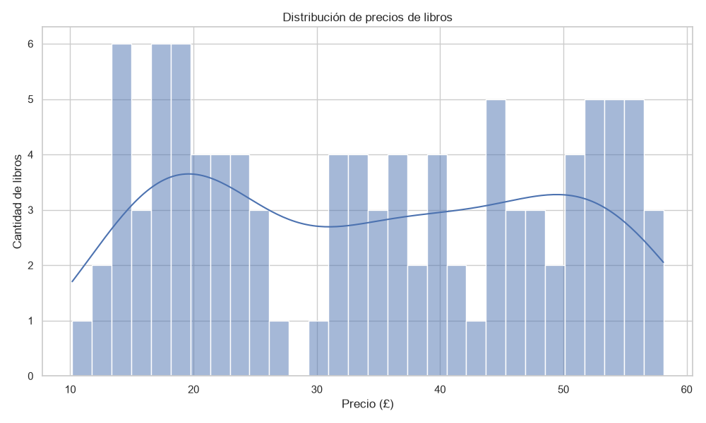
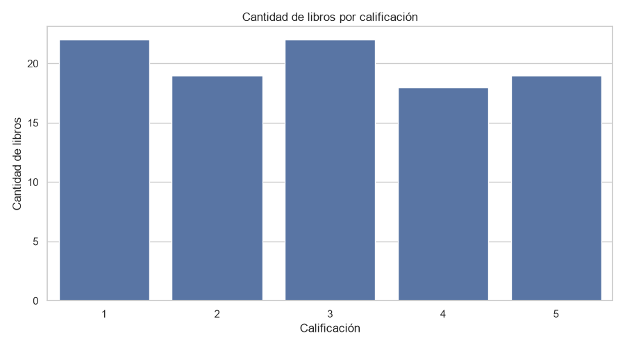
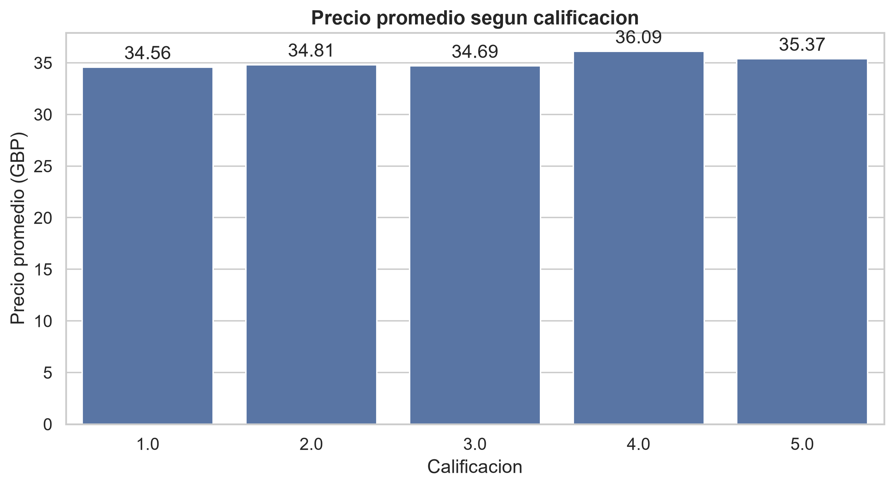
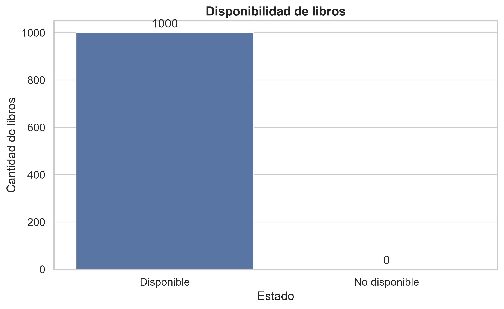
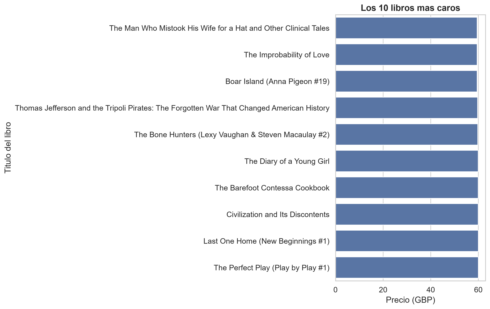
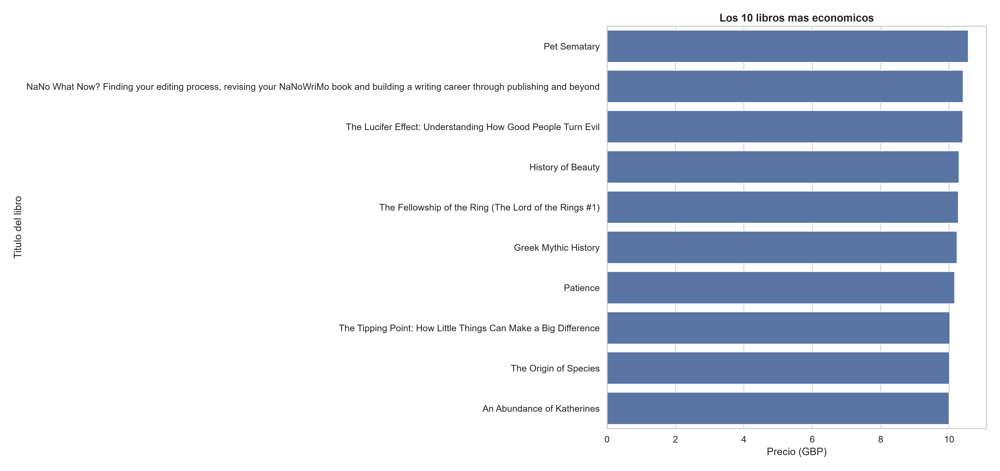

# Python Web Scraping & Data Analysis

Proyecto de extracción, limpieza, análisis y visualización de datos desarrollado con Python. El sistema obtiene información de un catálogo de libros mediante Web Scraping, procesa los registros con Pandas, genera seis visualizaciones estadísticas y produce automáticamente un informe en PDF.

## Tecnologías utilizadas

- Python 3.12
- Requests
- BeautifulSoup
- Pandas
- Matplotlib
- Seaborn
- ReportLab
- Pytest

## Funcionalidades

1. Extracción automática de información de libros.
2. Navegación por múltiples páginas del catálogo.
3. Implementación de mecanismos de reintento ante errores de conexión.
4. Limpieza y transformación de datos.
5. Eliminación de registros duplicados.
6. Validación de precios y calificaciones.
7. Análisis estadístico de los datos recopilados.
8. Generación de seis gráficos estadísticos.
9. Creación automática de informes PDF.
10. Pruebas automatizadas de los componentes principales.

## Estructura del proyecto

```text
portfolio_web_scraping/
│
├── data/
│
├── reports/
│   ├── 01_distribucion_precios.png
│   ├── 02_calificaciones.png
│   ├── 03_precio_por_calificacion.png
│   ├── 04_disponibilidad.png
│   ├── 05_libros_mas_caros.png
│   ├── 06_libros_mas_economicos.png
│   └── informe_analisis_libros.pdf
│
├── tests/
│   ├── test_parser.py
│   ├── test_analysis.py
│   ├── test_visualization.py
│   └── test_report.py
│
├── scraper.py
├── analyze_data.py
├── visualize_data.py
├── generate_report.py
├── requirements.txt
└── README.md
```

## Instalación

Clonar el repositorio:

```bash
git clone https://github.com/japazac3/portfolio-web-scraping.git
cd portfolio-web-scraping
```

Crear un entorno virtual:

```bash
python -m venv .venv
```

Activar el entorno virtual en Windows:

```powershell
.venv\Scripts\Activate.ps1
```

Instalar las dependencias:

```bash
pip install -r requirements.txt
```

## Ejecución del proyecto

Ejecutar los módulos en el siguiente orden:

**1. Extracción de datos**

```bash
python scraper.py --max-pages 50
```

**2. Limpieza y análisis**

```bash
python analyze_data.py
```

**3. Generación de visualizaciones**

```bash
python visualize_data.py
```

**4. Generación del informe PDF**

```bash
python generate_report.py
```

## Resultados y visualizaciones

El proyecto genera seis gráficos estadísticos:

### 1. Distribución de precios



### 2. Calificaciones de libros



### 3. Precio según calificación



### 4. Disponibilidad de libros



### 5. Libros más caros



### 6. Libros más económicos



## Informe automático en PDF

El sistema genera un informe que contiene indicadores estadísticos, gráficos y conclusiones del análisis.

[Consultar informe de análisis de libros](reports/informe_analisis_libros.pdf)

## Pruebas automatizadas

El proyecto utiliza Pytest para comprobar el funcionamiento de sus componentes.

Ejecutar todas las pruebas:

```bash
python -m pytest -v
```

Cobertura de las pruebas:

- Extracción de información y navegación por páginas.
- Limpieza y validación de datos.
- Generación de visualizaciones.
- Creación y validación de informes PDF.
- Manejo de datos y archivos inválidos.

**Estado de validación:** 15 pruebas superadas.

## Fuente de datos

Proyecto educativo: [Books to Scrape](https://books.toscrape.com/).

La extracción se realiza con fines de aprendizaje y respetando las condiciones del sitio.

## Objetivo profesional

Demostrar conocimientos prácticos en Python, Web Scraping, automatización, procesamiento de datos, análisis estadístico, visualización de información y generación automatizada de informes.
